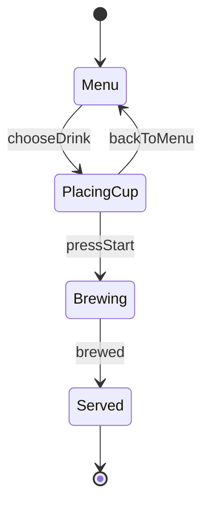

:::message
釣りタイトルです！Content Mapperを使って全く役に立たないものを作ってしまっています！
役立つContent Mapperの使い方は TSKaigi Sendai 2026のuhyoさんの「[Content Mapper APIの応用例〜CSS Modules、言語ファイル〜](https://speakerdeck.com/uhyo/content-mapper-api-no-ouyou-rei-css-modules-gengo-fairu) が分かりやすいです
:::

Mermaid の状態遷移図を `.mmd` のまま import して、TypeScript の型として扱えるようにしてみました。図から矢印を1本消すと、その矢印を使っていたコードが型エラーになります。


使っているのは、TypeScript 7.1 Beta で導入された Content Mapper です。コードは [super-himetan/mermaid-machine](https://github.com/super-himetan/mermaid-machine) に置いています。

:::message
執筆時点の TypeScript は `7.1.0-beta` です。API や設定は正式版までに変わる可能性があります。
:::

## Content Mapper とは

`.ts` ではないファイルを、仮想的な TypeScript に変換するプラグインの仕組みです。拡張子ごとに `tsconfig.json` に登録します。変換後のコードと元のファイルの位置の対応も一緒に渡すので、エラーやエディタの機能が元のファイルの上で動きます。詳しくは[公式の発表記事](https://devblogs.microsoft.com/typescript/announcing-typescript-7-1-beta/)にあります。


## 図は有向グラフとして読める

状態遷移図は、状態を頂点、イベントを辺とする有向グラフです。説明用に、リポジトリのデモより小さな図で試します。

```text:src/coffee.mmd
stateDiagram-v2
  [*] --> Menu
  Menu --> PlacingCup: chooseDrink
  PlacingCup --> Menu: backToMenu
  PlacingCup --> Brewing: pressStart
  Brewing --> Served: brewed
  Served --> [*]
```



mapper はこの図を、次のような型に変換します（抜粋）。「どの状態から、どのイベントで、どの状態へ」がそのまま型になっています。

```ts
export interface Graph {
  readonly initial: "Menu";
  readonly finals: readonly ("Served")[];
  readonly states: {
    readonly Menu: {
      /** Menu --> PlacingCup */
      readonly chooseDrink: "PlacingCup";
    };
    readonly PlacingCup: {
      /** PlacingCup --> Menu */
      readonly backToMenu: "Menu";
      /** PlacingCup --> Brewing */
      readonly pressStart: "Brewing";
    };
    readonly Brewing: {
      /** Brewing --> Served */
      readonly brewed: "Served";
    };
    readonly Served: {};
  };
}
```

グラフが型になると、できることが2つあります。

## 1. 図にない遷移を書けなくする

この図から `defineMachine` も生成しているので、呼び出しの順番を図の通りに制限できます。

```ts:src/use.ts
import { defineMachine } from "./coffee.mmd";

const coffee = defineMachine({ initialData: {}, transitions: {}, actions: {} });

coffee.start().chooseDrink().pressStart().brewed();
coffee.start().chooseDrink().backToMenu();
```

図から `PlacingCup --> Menu: backToMenu` を消すと、6行目がエラーになります。

```text
src/use.ts(6,30): error TS2339: Property 'backToMenu' does not exist on type 'Flow<Graph, Data, Payloads, "PlacingCup">'.
```

React でも同じです。[リポジトリのデモ](https://github.com/super-himetan/mermaid-machine)はもう少し大きな図を使っていて、状態ごとに `send` の補完が変わります。


## 2. グラフの性質を型で検査する

矢印が型になっているので、型の上でグラフをたどって、到達可能性を計算できます。すると「カップをセットせずに抽出は始まらない」のようなルールを、型で書けます。

```ts:src/rules.ts
import type { Graph } from "./coffee.mmd";
import type { MustPass } from "./workflow.ts";

type Rule<T extends true> = T;

export type Rules = [
  // カップをセットせずに抽出は始まらない
  Rule<MustPass<Graph, "Menu", "Brewing", "PlacingCup">>,
];
```

`MustPass` は、`PlacingCup` を通らずに `Menu` から `Brewing` へ行けるかを調べます。行けなければ、どの経路も `PlacingCup` を通るということなので `true` です。定義は [workflow.ts](https://github.com/super-himetan/mermaid-machine/blob/main/tests/workflow.ts) にあります。

ここで図に近道を足します。

```text
  Menu --> Brewing: quickStart
```

図としては何も間違っていませんが、ルールは破れているので型エラーになります。

```text
src/rules.ts(8,8): error TS2344: Type 'false' does not satisfy the constraint 'true'.
```

テストを実行しなくても、図を変えた時点で気づけます。

## 図の中にもエラーを出せる

mapper は、変換結果と一緒に診断も返せます。今回は図を解析して、到達できない状態やフィールドの間違いを報告しています。状態名を `Sarved` と間違えると、`Served` にたどり着けなくなります。

```text
src/coffee.mmd(6,15): error mermaid9105: State 'Sarved' has no path to a final state.
src/coffee.mmd(7,3): error mermaid9104: State 'Served' can never be reached from 'Menu'.
```

エディタでは `.mmd` に赤線が出ます。次の GIF はデモの図で、状態が持つフィールドを間違えています。Mermaid にとってはただの説明文なので、プレビューは正常に描画されたままです。


## 位置の対応がリネームまで決める

Content Mapper で一番面白かったのは、生成するコードの書き方で、エディタの動きが変わるところです。ここではイベント名の出力を抜粋します。

```js
if (machine.renameableEvents.has(event)) b.appendVerbatim(eventSpan.start, eventSpan.end);
else writeFixed(event, eventSpan);
```

`appendVerbatim` は `.mmd` の範囲をそのまま生成コードに写します。これで `send.backToMenu` を `App.tsx` からリネームすると、`.mmd` の中の名前まで書き換わります。

ただ、これが安全なのは1か所にしか書かれていない名前だけです。複数の矢印で使うイベントや状態名まで同じようにすると、1か所だけ書き換わって図が壊れます。そこで `writeFixed` では、リネームの機能だけを外して対応を付けています。その場合も、TS 側からのリネームを止めることはできず、`.ts` だけが変わって型エラーになります。

## 型だけでは足りないところ

- Content Mapper は `tsc` とエディタのための仕組みなので、実行時に `.mmd` を読むには別の手段が必要です。今回は同じコンパイラを使う Vite プラグインを作りました。
- ハンドラの消し忘れや、ボタンの作り忘れは型では検出できません。そこはテストで確認しています。


## まとめ

図を有向グラフとして型にすると、遷移の制限だけでなく、経路のルールまでコンパイル時に検査できました。
正直実務で生かそうとするとデータが増えてグラフは複雑になりそうなので、私はコードで読めれば十分だなと思いました。
気が向いたらちゃんと使いものになるContent Mapperの使い方も書こうと思います。
