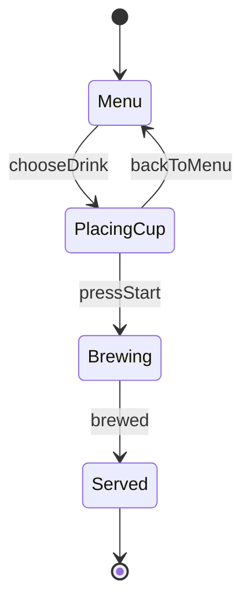

:::message
釣りタイトルです！Content Mapperを使って全く役に立たないものを作ってしまっています！
役立つContent Mapperの使い方は TSKaigi Sendai 2026のuhyoさんの「[Content Mapper APIの応用例〜CSS Modules、言語ファイル〜](https://speakerdeck.com/uhyo/content-mapper-api-no-ouyou-rei-css-modules-gengo-fairu) が分かりやすいです
:::

Mermaid の状態遷移図を `.mmd` のまま import して、TypeScript の型として扱えるようにしてみました。図から矢印を1本消すと、その矢印を使っていたコードが型エラーになります。


使っているのは、TypeScript 7.1 Beta で導入された Content Mapper です。この記事では、同じ仕組みを40行ほどの mapper で作りながら説明します。記事のコードだけで動きます。

:::message
執筆時点の TypeScript は `7.1.0-beta` です。API や設定は正式版までに変わる可能性があります。
:::

## Content Mapper とは

`.ts` ではないファイルを、仮想的な TypeScript に変換するプラグインの仕組みです。変換後のコードと元のファイルの位置の対応も一緒に渡すので、エラーやエディタの機能が元のファイルの上で動きます。詳しくは[公式の発表記事](https://devblogs.microsoft.com/typescript/announcing-typescript-7-1-beta/)にあります。

## 作るもの

題材はコーヒーマシンの状態遷移図です。メニューを選び、カップをセットして、抽出すると提供されます。



ソースはこれです。

```text:src/coffee.mmd
stateDiagram-v2
  [*] --> Menu
  Menu --> PlacingCup: chooseDrink
  PlacingCup --> Menu: backToMenu
  PlacingCup --> Brewing: pressStart
  Brewing --> Served: brewed
  Served --> [*]
```

状態遷移図は、状態を頂点、イベントを辺とする有向グラフです。そこで、この図を次の型に変換します。「どの状態から、どのイベントで、どの状態へ」がそのまま型になります。

```ts
export interface Graph {
  Menu: {
    chooseDrink: "PlacingCup";
  };
  PlacingCup: {
    backToMenu: "Menu";
    pressStart: "Brewing";
  };
  Brewing: {
    brewed: "Served";
  };
  Served: {
  };
}
```

## mapper を書く

mapper は npm パッケージの形で作ります。`package.json` に、実行するコマンドを書きます。

```json:mmd-mapper/package.json
{
  "name": "mmd-mapper",
  "type": "module",
  "dependencies": { "ts-content-mapper": "0.1.1" },
  "typescript": {
    "contentMapper": {
      "exec": ["node", "server.mjs"],
      "compilerOptions": [],
      "dynamicConfig": false
    }
  }
}
```

本体です。[ts-content-mapper](https://github.com/sxzz/ts-content-mapper) という SDK を使うと、図を読んで TypeScript の文字列を組み立てるだけで済みます。

```js:mmd-mapper/server.mjs
import { MappedCodeBuilder, runContentMapper } from "ts-content-mapper";

runContentMapper({
  diagnosticSource: "mermaid",
  transform({ content }, { positionEncoding }) {
    // 矢印を読み取って、状態ごとにまとめる
    const edges = [...content.matchAll(/^\s*(\w+) --> (\w+): (\w+)$/dgm)];
    const states = new Set(edges.flatMap(([, from, to]) => [from, to]));

    const b = new MappedCodeBuilder(content, { positionEncoding });
    b.append("export interface Graph {\n");
    for (const state of states) {
      b.append(`  ${state}: {\n`);
      for (const edge of edges.filter(([, from]) => from === state)) {
        const [start, end] = edge.indices[3]; // イベント名の位置
        b.append("    ");
        b.appendVerbatim(start, end);
        b.append(`: "${edge[2]}";\n`);
      }
      b.append("  };\n");
    }
    b.append("}\n");

    // 図の間違いは、位置を付けて報告できる
    const diagnostics = edges
      .filter(([, , to]) => !edges.some(([, from]) => from === to) && !content.includes(`${to} --> [*]`))
      .map((edge) => ({
        code: 1,
        messageText: `State '${edge[2]}' has no way out.`,
        start: edge.indices[2][0],
        length: edge[2].length,
      }));

    return { ...b.build(".ts"), diagnostics };
  },
});
```

`append` はただの文字列の追加で、`appendVerbatim` は「`.mmd` のこの範囲をそのまま写す」という命令です。後者で書いた部分は、元の位置との対応が残ります。これが後で効いてきます。

あとは `tsconfig.json` に登録します。`mmd-mapper` は `node_modules` から見つかるように、`"mmd-mapper": "link:./mmd-mapper"` などで依存に入れておきます。

```json:tsconfig.json
{
  "compilerOptions": { "module": "esnext", "moduleResolution": "bundler", "strict": true, "noEmit": true, "types": [] },
  "contentMappers": [{ "package": "mmd-mapper", "extensions": [".mmd"] }],
  "include": ["src"]
}
```

mapper は外部のプログラムとして動くので、`tsc` では `--runExternalCode` で実行を許可します。

```bash
tsc --runExternalCode
```

これで `.mmd` から型を import できるようになりました。

## 図にない遷移を書けなくする

`Graph` を使って、今いる状態から出ている矢印だけをメソッドにする型を作ります。

```ts:src/flow.ts
import type { Graph } from "./coffee.mmd";

// 今いる状態から出ている矢印だけが、メソッドになる
type Flow<S extends keyof Graph> = {
  [Event in keyof Graph[S]]: () => Flow<Graph[S][Event] & keyof Graph>;
};

declare const menu: Flow<"Menu">;

menu.chooseDrink().pressStart().brewed();
menu.chooseDrink().backToMenu();
```

`Menu` からいきなり `pressStart` は呼べません。図に矢印がないからです。

ここで図から `PlacingCup --> Menu: backToMenu` を消すと、11行目がエラーになります。

```text
src/flow.ts(11,20): error TS2339: Property 'backToMenu' does not exist on type 'Flow<"PlacingCup">'.
```

## グラフの性質を型で検査する

矢印が型になっているので、型の上でグラフをたどることもできます。すると「カップをセットせずに抽出は始まらない」のようなルールを型で書けます。

```ts:src/rules.ts
import type { Graph } from "./coffee.mmd";

// S から矢印を1本たどって行ける状態
type Next<S> = S extends keyof Graph ? Graph[S][keyof Graph[S]] : never;

// From からたどれる状態をすべて集める。Avoid には入らない
type Reachable<From, Avoid, Seen = never> = [Exclude<From, Seen | Avoid>] extends [never]
  ? Seen
  : Reachable<Next<Exclude<From, Seen | Avoid>>, Avoid, Seen | Exclude<From, Avoid>>;

// Via を避けると To に行けないなら、To へはかならず Via を通る
type MustPass<From, To, Via> = To extends Reachable<From, Via> ? false : true;

type Rule<T extends true> = T;

export type Rules = [
  // カップをセットせずに抽出は始まらない
  Rule<MustPass<"Menu", "Brewing", "PlacingCup">>,
];
```

やっていることは、型で書いた幅優先探索です。`PlacingCup` を通行止めにしてたどり、`Brewing` に着かなければ、すべての経路が `PlacingCup` を通っています。

ここで図に近道を足します。

```text
  Menu --> Brewing: quickStart
```

図としては何も間違っていませんが、ルールは破れているので型エラーになります。

```text
src/rules.ts(18,8): error TS2344: Type 'false' does not satisfy the constraint 'true'.
```

テストを実行しなくても、図を変えた時点で気づけます。

## 図の中にエラーを出す

mapper が返した `diagnostics` は、`.mmd` の上のエラーになります。`Served` を `Sarved` と間違えると、次のように出ます。

```text
src/coffee.mmd(6,15): error mermaid1: State 'Sarved' has no way out.
```

エディタでは `.mmd` に赤線が出ます。次の GIF は、後で紹介するもう少し作り込んだ版です。状態が持つデータの名前を間違えていますが、Mermaid にとってはただの説明文なので、プレビューは正常に描画されたままです。


## リネームが図まで届く

Content Mapper で一番面白かったのは、生成するコードの書き方で、エディタの動きが変わるところです。

イベント名は `appendVerbatim` で写したので、`.mmd` と対応が付いています。そのため `flow.ts` の `backToMenu` をリネームすると、`.mmd` の中の名前まで書き換わります。

ただ、これが安全なのは1か所にしか書かれていない名前だけです。同じイベントを複数の矢印で使う図や、状態名まで同じようにすると、1か所だけ書き換わって図が壊れます。

## もう少し作り込むと

ここまでは型だけで、実際には動きません。Content Mapper は `tsc` とエディタのための仕組みなので、実行時に `.mmd` を読むには別の手段が必要です。

[super-himetan/mermaid-machine](https://github.com/super-himetan/mermaid-machine) では、Vite プラグインを足して実際に動かしています。React では、今の状態から送れるイベントだけが `send` に生えるようにしました。


## まとめ

図を有向グラフとして型にすると、遷移の制限だけでなく、経路のルールまでコンパイル時に検査できました。
正直実務で生かそうとするとデータが増えてグラフは複雑になりそうなので、私はコードで読めれば十分だなと思いました。
気が向いたらちゃんと使いものになるContent Mapperの使い方も書こうと思います。
