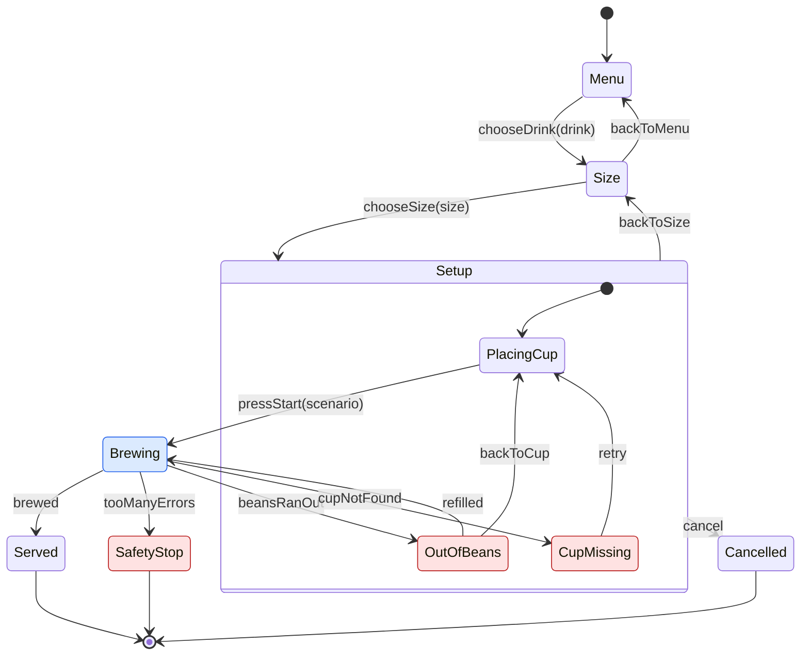

TypeScript 7.1 Beta で導入された Content Mapper を使って、Mermaid の状態遷移図をそのまま TypeScript の型として扱えるようにしてみました。

図から矢印を1本消すと、その矢印を使っていた React のコードが型エラーになります。


コードはこちらに置いています。

https://github.com/super-himetan/mermaid-machine

:::message
執筆時点の TypeScript は `7.1.0-beta` です。Content Mapper の API や設定は、正式版までに変わる可能性があります。
:::

## TypeScript 7.1 で Content Mapper が導入された

[TypeScript 7.1 Beta の発表記事](https://devblogs.microsoft.com/typescript/announcing-typescript-7-1-beta/)で、Content Mapper という仕組みが紹介されました。

`.ts` ではないファイルを、拡張子ごとに登録したプラグインが仮想的な TypeScript に変換します。元のファイルとの対応関係も一緒に渡すので、エラーの場所やエディタの機能を元のファイルに届けられます。Vue や Svelte のような単一ファイル形式のために使われてきた仕組みを、TypeScript 本体に取り込んだ形です。

設定は `tsconfig.json` に書きます。

```json:tsconfig.json
{
  "contentMappers": [{ "package": "mermaid-machine", "extensions": [".mmd"] }]
}
```

mapper は外部のプログラムとして実行されるので、`tsc` では実行の許可を明示する必要があります。

```bash
tsc --noEmit --runExternalCode
```

## TSKaigi Sendai 2026 でも話題になっていた

TSKaigi Sendai 2026 では、うひょさんの「[Content Mapper APIの応用例〜CSS Modules、言語ファイル〜](https://sendai.tskaigi.org/talks/5)」というセッションがありました。CSS Modules と言語ファイルに型チェックを効かせる応用例の話で、私はスライドだけ拝見しました。

<!-- TODO: スライドの URL が分かれば追加する -->

CSS や言語ファイルのように「元々あるファイルの中身を型にする」と考えると、他にも使えそうなものがありそうです。そこで試してみたのが Mermaid です。

## Mermaid の図を有向グラフとして型にする

状態遷移図は、状態を頂点、イベントを辺とする有向グラフと見なせます。つまり、図を読めば「どの状態からどのイベントで、どの状態に移れるか」が全部分かります。

ドキュメントとして書いた図と実装は、放っておくとだんだんずれていきます。図そのものが型になれば、ずれた時点でコンパイルが通らなくなるはずです。

題材はコーヒーマシンです。



実際の `.mmd` には、Mermaid のコメントとして各フィールドの型も書いています。右辺は TypeScript の型としてそのまま検査されます。

```text:src/coffee.mmd
stateDiagram-v2
  %% field drink: "コーヒー" | "カフェラテ" | "抹茶ラテ"
  %% field size: "S" | "M" | "L"
  %% field errors: number
  %% field scenario: import("./brew.ts").Scenario

  [*] --> Menu
  Menu --> Size: chooseDrink(drink)

  Size: Size
  Size: drink
```

`%%` はただのコメントなので、Mermaid の図としてもそのまま描画できます。

### 図から生成される型

mapper は、この図から次のような型を生成します（抜粋）。

```ts
export interface Graph {
  readonly initial: "Menu";
  readonly finals: readonly ("Served" | "SafetyStop" | "Cancelled")[];
  readonly autoStates: readonly ("Brewing")[];
  readonly errorStates: readonly ("CupMissing" | "OutOfBeans" | "SafetyStop")[];
  readonly states: {
    /** Fields: none */
    readonly Menu: {
      /** Menu --> Size */
      readonly chooseDrink: "Size";
    };
    /** Fields: drink */
    readonly Size: {
      /** Size --> Menu */
      readonly backToMenu: "Menu";
      /** Size --> Setup */
      readonly chooseSize: "PlacingCup";
    };
    // ...
  };
}
```

`Setup` のような複合状態は展開されていて、`Setup --> Cancelled: cancel` の1本の矢印は、中にある各状態の `cancel` になります。JSDoc も生成しているので、ホバーすると図の矢印が表示されます。

mapper 本体は、[ts-content-mapper](https://github.com/sxzz/ts-content-mapper) を使うと短く書けます。

```js:mapper/server.mjs
import { MappedCodeBuilder, runContentMapper } from "ts-content-mapper";
import { compile, writeTypes } from "./codegen.mjs";

runContentMapper({
  diagnosticSource: "mermaid",
  transform(params, context) {
    const machine = compile(params.content);
    const builder = new MappedCodeBuilder(params.content, {
      positionEncoding: context.positionEncoding,
    });
    writeTypes(machine, builder);
    return { ...builder.build(".ts"), diagnostics: machine.diagnostics };
  },
});
```

### 使う側のコード

`.mmd` を普通のモジュールとして import します。

```ts:src/coffee.machine.ts
import { brew } from "./brew.ts";
import { defineMachine } from "./coffee.mmd";

const MAX_ERRORS = 3;

export const coffee = defineMachine({
  initialData: {},
  // 変わる値だけ書く。他のフィールドは図に従って持ち越される
  transitions: {
    chooseSize: () => ({ errors: 0 }),
    cupNotFound: ({ errors }) => ({ errors: errors + 1 }),
    tooManyErrors: ({ errors }) => ({ errors: errors + 1 }),
    refilled: () => ({ scenario: "ok" }),
  },
  actions: {
    Brewing: async ({ scenario, errors }, signal) => {
      const result = await brew(scenario, signal);
      if (result === "ok") return "brewed";
      if (result === "noBeans") return "beansRanOut";
      return errors + 1 >= MAX_ERRORS ? "tooManyErrors" : "cupNotFound";
    },
  },
});
```

React 側では、状態ごとに `data` と `send` の型が絞られます。

```tsx:src/App.tsx
const m = useMachine(coffee);

const view = coffee.render(m, {
  Size: ({ data, send }) => (
    <>
      <h2>{data.drink}のサイズは？</h2>
      <button onClick={() => send.backToMenu()}>メニューに戻る</button>
    </>
  ),
  // 全状態のビューを書かないと型エラーになる
});
```


## 図を変えると何が起きるか

ここからのエラーは、すべて `tsc` の実際の出力です。

### 矢印を消すと、使っていたコードがエラーになる

`Size --> Menu: backToMenu` を消します。

```text
src/App.tsx(41,39): error TS2339: Property 'backToMenu' does not exist on type 'SendFrom<Graph, Payloads, "Size">'.
```

### 図の間違いは図の上でエラーになる

mapper から返した診断は、`.mmd` の該当箇所に出ます。フィールド名を間違えると、こうなります。

```text
src/coffee.mmd(36,9): error mermaid9113: 'drnk' has no '%% field drnk: ...' line.
```

エディタでも、図の中に直接赤線が出ます。`Size: drnk` は Mermaid から見ればただの説明文なので、図としては正しいままです。後半では `%% field size` を `sizee` に変えていて、使っている箇所すべてに赤線が出ます。


`Sise` のように状態名を間違えると、グラフとして繋がらなくなるので、到達できない状態の検査に引っかかります。

```text
src/coffee.mmd(9,12): error mermaid9105: State 'Sise' has no path to a final state.
src/coffee.mmd(10,3): error mermaid9104: State 'Size' can never be reached from 'Menu'.
```

`%% field` の右辺は TypeScript の型として検査されるので、TypeScript のエラーも `.mmd` の中に出ます。

```text
src/coffee.mmd(4,18): error TS2304: Cannot find name 'Sizee'.
```

### 「図にない順番」のコードが書けない

各イベントが次の状態を返す `Flow` という型を用意すると、呼び出しの順番も図の通りでないとコンパイルできません。

```ts
const menu = coffee.start();
// @ts-expect-error Size は飛ばせない
menu.chooseSize({ size: "M" });

const served = menu
  .chooseDrink({ drink: "コーヒー" })
  .chooseSize({ size: "M" })
  .pressStart({ scenario: "ok" })
  .brewed();

served.data.size; // "S" | "M" | "L"
```

### グラフの性質を型で検査する

ここが有向グラフとして扱う一番の面白さだと思います。型レベルで到達可能性を計算できるので、業務ルールをグラフの性質として書けます。

```ts:tests/workflow.ts
type Next<G extends GraphShape, S> = S extends StateOf<G>
  ? G["states"][S][keyof G["states"][S]] & StateOf<G>
  : never;

type Walk<G extends GraphShape, Frontier, Seen, Avoid> = [Exclude<Frontier, Seen | Avoid>] extends [never]
  ? Seen
  : Walk<G, Next<G, Exclude<Frontier, Seen | Avoid>>, Seen | Exclude<Frontier, Avoid>, Avoid>;

export type ReachableFrom<G extends GraphShape, From extends StateOf<G>, Avoid = never> = Walk<G, From, never, Avoid>;

/** From から To へのどの経路も Via を通るなら true */
export type MustPass<
  G extends GraphShape,
  From extends StateOf<G>,
  To extends StateOf<G>,
  Via extends StateOf<G>,
> = [To & ReachableFrom<G, From, Via>] extends [never] ? true : false;
```

`Via` を通らずに `To` へ着けないなら、すべての経路が `Via` を通るということです。これでルールを並べます。

```ts:tests/coffee.rules.ts
export type Rules = [
  // サイズを選ばずに抽出は始まらない
  Rule<MustPass<G, "Menu", "Brewing", "Size">>,
  // カップをセットせずに抽出は始まらない
  Rule<MustPass<G, "Menu", "Brewing", "PlacingCup">>,
  // 提供したあとにキャンセルされない
  Rule<NeverAfter<G, "Served", "Cancelled">>,
];
```

試しに `Size --> Brewing: chooseSize(size)` と書き換えて、カップのセットを飛ばせるようにすると、ルールが失敗します。

```text
tests/coffee.rules.ts(12,8): error TS2344: Type 'false' does not satisfy the constraint 'true'.
```

テストを実行しなくても、図を変えた時点で「カップなしで抽出できてしまう」ことが分かります。

## 作ってみて分かったこと

### Content Mapper が担当するのは型の世界だけ

Content Mapper は `tsc` とエディタのための仕組みなので、実行時に `.mmd` を読むには別の手段が必要です。今回は Vite プラグインを作り、同じコンパイラを使って `.mmd` を JavaScript に変換しました。

```ts
export function mermaidMachine() {
  return {
    name: "mermaid-machine",
    enforce: "pre",
    transform(code, id) {
      if (!id.split("?")[0].endsWith(".mmd")) return;
      return { code: toJs(code), map: null };
    },
  };
}
```

（診断の処理は省略しています）

### リネームは対応の付け方で決まる

イベント名を `App.tsx` からリネームすると、`.mmd` の中まで書き換わります。ただ、これができるのは1本の矢印だけで使われているイベントです。

状態名やフィールド名は図の複数箇所に書かれるので、そのままリネームすると1箇所だけ変わって図が壊れてしまいます。そこで図の上ではリネームできないようにしました。コード側からリネームした場合は `.ts` だけが変わりますが、型エラーになるので気づけます。

```js
const NO_RENAME = SpanMapFeature.All & ~SpanMapFeature.Rename;
```

### 型では検出できないものもある

ハンドラの消し忘れや、画面にボタンを作り忘れたことは型では検出できません。そこは今までどおりシナリオテストで確認しています。

## 手元で試す

```bash
git clone https://github.com/super-himetan/mermaid-machine.git
cd mermaid-machine
pnpm install
pnpm check
pnpm dev
```

VS Code では、拡張機能 `TypeScriptTeam.native-preview` を入れてこのフォルダを開くと動きます。`.vscode/settings.json` がプロジェクトの TypeScript を指定しています。

## まとめ

- TypeScript 7.1 の Content Mapper で、`.ts` 以外のファイルの中身を型にできるようになった
- Mermaid の状態遷移図を有向グラフと見なすと、遷移だけでなく「必ずここを通る」のようなルールまで型で検査できる
- 図を変えるとコードが型エラーになるので、図と実装がずれにくくなる

「元々あるファイルの中身を型にする」という使い方は、CSS や言語ファイル、今回の図以外にもまだありそうです。正式版が楽しみです。
