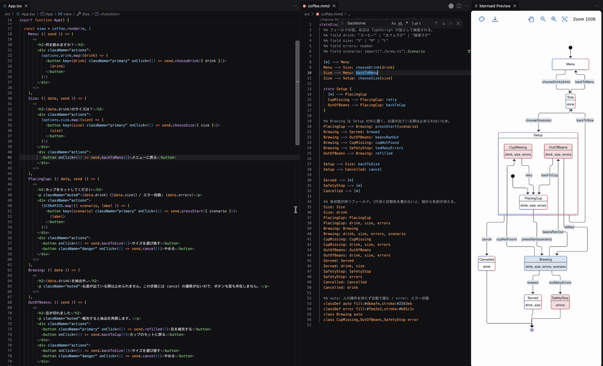
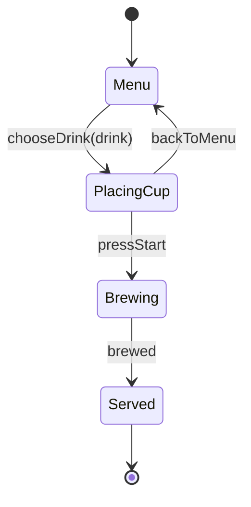
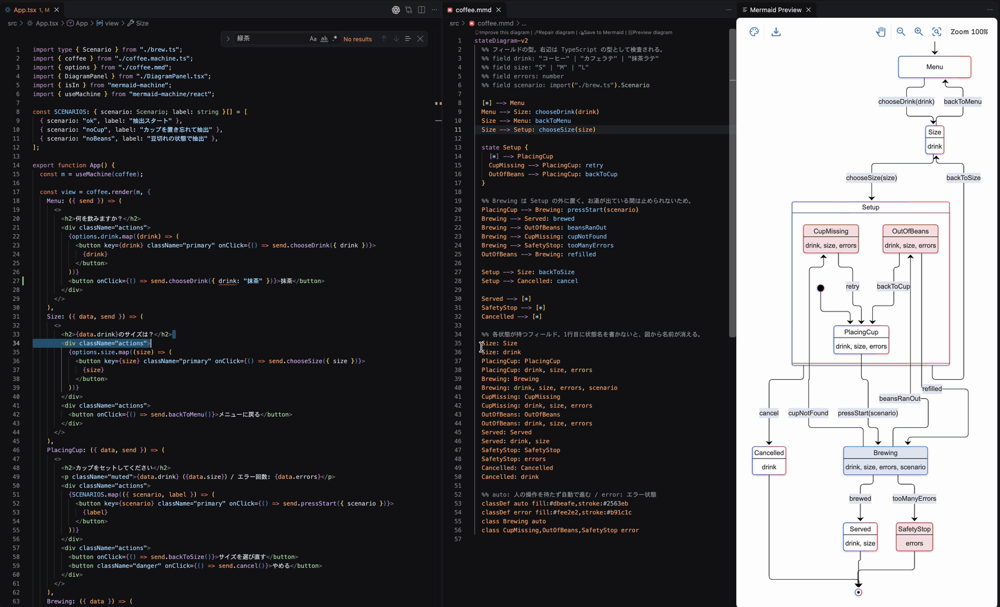
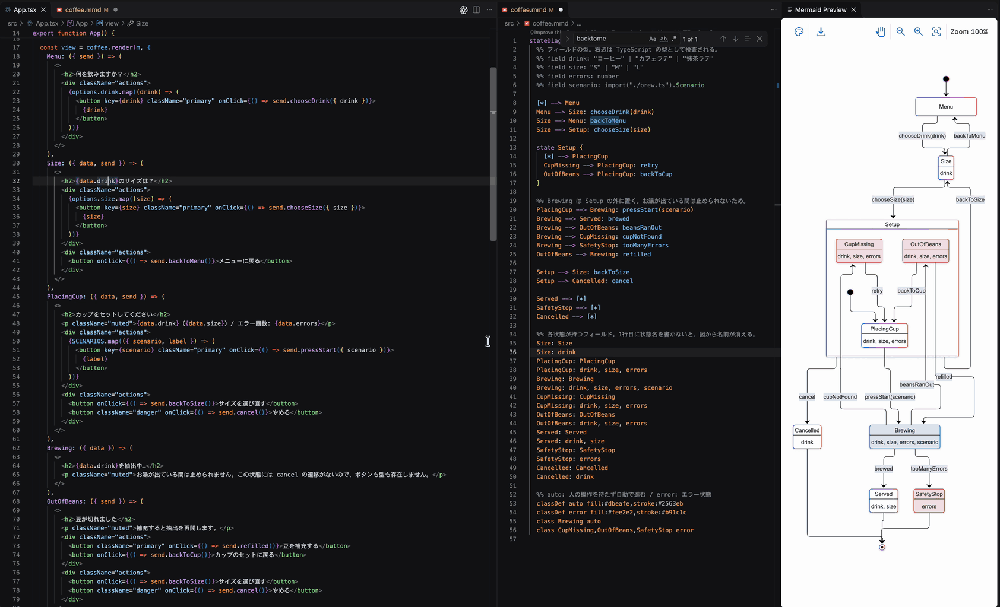

:::message
釣りタイトルです！Content Mapperを使って全く役に立たないものを作ってしまっています！
役立つContent Mapperの使い方は TSKaigi Sendai 2026のuhyoさんの「[Content Mapper APIの応用例〜CSS Modules、言語ファイル〜](https://speakerdeck.com/uhyo/content-mapper-api-no-ouyou-rei-css-modules-gengo-fairu)」が分かりやすいです。
:::

Mermaid の状態遷移図を、TypeScript の型として扱えるようにしてみました。Mermaidの図から矢印を1本消すと、その矢印を使っていたコードは型エラーになります。



使っているのは、TypeScript 7.1 Beta で導入された [Content Mapper](https://devblogs.microsoft.com/typescript/announcing-typescript-7-1-beta/) です。`.ts` ではないファイルを仮想的な TypeScript に変換する仕組みで、エラーやエディタの機能が元のファイルの上で動きます。

:::message
執筆時点の TypeScript は `7.1.0-beta` です。API や設定は正式版までに変わる可能性があります。
:::


## Mermaid図を有向グラフと見立てて型に変換する

コーヒーマシンの状態遷移図を `coffee.mmd` として用意します。



ソースには、図に出てこない次の1行も書いています。`%%` は Mermaid のコメントなので、描画には影響しません。

```text
%% field drink: "コーヒー" | "カフェラテ" | "抹茶ラテ"
```

この状態遷移図を、状態を頂点、イベントを辺とする有向グラフと見立てています。そこで、これを次の型に変換します。

```ts
export interface Graph {
  Menu: {
    chooseDrink: "PlacingCup";
  };
  PlacingCup: {
    backToMenu: "Menu";
    pressStart: "Brewing";
  };
  Brewing: {
    brewed: "Served";
  };
  Served: {
  };
}
export interface Fields {
  drink: "コーヒー" | "カフェラテ" | "抹茶ラテ";
}
export interface Payloads {
  chooseDrink: { drink: Fields["drink"] };
}
```

Content Mapperを使うことで`import type { Graph } from "./coffee.mmd"` とMermaidをimportするように書けば、この型を使うことができます。
そうすることで3つのことができるようになります。

## 図にない遷移を書けなくする

今いる状態から出ている矢印だけをメソッドにすると、呼び出しの順番が図の通りに制限されます。

```ts
menu.chooseDrink({ drink: "コーヒー" }).pressStart().brewed(); // OK
menu.pressStart(); // エラー: Menu から pressStart の矢印はない
```

図を変えれば、コードの正しさも変わります。`PlacingCup --> Menu: backToMenu` を消すと、`backToMenu` を呼んでいたコードがエラーになります。

```text
Property 'backToMenu' does not exist on type 'Flow<"PlacingCup">'.
```

たとえばReactを使う場合、今の状態から送れるイベントだけをイベントハンドラーとして補完に出るようにもできます。


## 引数も図の型で制御する

矢印に書いた `chooseDrink(drink)` の `drink` は、イベントの引数です。型は `%% field drink` に書いたものがそのまま使われます。

```ts
menu.chooseDrink({ drink: "コーヒー" }); // OK
menu.chooseDrink({ drink: "抹茶" }); // エラー: 図にない飲み物
menu.chooseDrink(); // エラー: 引数が必要
menu.chooseDrink({ drink: "コーヒー" }).pressStart({ drink: "コーヒー" }); // エラー: pressStart に引数はない
```

```text
Type '"抹茶"' is not assignable to type '"カフェラテ" | "コーヒー" | "抹茶ラテ"'.
```

メニューを変えるときも、直すのは図だけです。図に `"抹茶"` を足せば上のコードは通るようになり、`"抹茶ラテ"` を消せば、それを渡していたコードがエラーになります。




## Mermaid記法の中に赤線を出す

mapper は、図の間違いを位置付きで報告できます。エディタでは `.mmd` の上に赤線が出ます。



この GIF では、状態が持つデータの名前を `drnk` と間違えています。Mermaid にとってはただの説明文なので、プレビューは正常に描画されたままです。図としては正しくても、型の世界では間違いとして扱えます。

リネームも図まで届きます。コードの `backToMenu` をリネームすると、`.mmd` の中の名前まで書き換わります。

## 実装

型の定義と mapper の全体です。mapper は58行で、図を読んで型の文字列を組み立てているだけです。興味があれば覗いてみてください。

:::details 図にない遷移を書けなくする型

```ts:src/flow.ts
import type { Graph, Payloads } from "./coffee.mmd";

// 今いる状態から出ている矢印だけが、メソッドになる
// 図に引数が書いてあるイベントは、その引数を必須にする
export type Flow<S extends keyof Graph> = {
  [Event in keyof Graph[S]]: (
    ...args: Event extends keyof Payloads ? [Payloads[Event]] : []
  ) => Flow<Graph[S][Event] & keyof Graph>;
};

declare const menu: Flow<"Menu">;

menu.chooseDrink({ drink: "コーヒー" }).pressStart().brewed();
menu.chooseDrink({ drink: "コーヒー" }).backToMenu();
```

:::

:::details mapper 本体と設定

[ts-content-mapper](https://github.com/sxzz/ts-content-mapper) という SDK を使っています。`appendVerbatim` は `.mmd` の範囲をそのまま写す命令で、元の位置との対応が残るので、リネームが図まで届きます。

```js:mmd-mapper/server.mjs
import { MappedCodeBuilder, runContentMapper } from "ts-content-mapper";

runContentMapper({
  diagnosticSource: "mermaid",
  transform({ content }, { positionEncoding }) {
    // 矢印とフィールドを読み取る
    const edges = [...content.matchAll(/^\s*(\w+) --> (\w+): (\w+)(?:\((\w+)\))?$/dgm)];
    const fields = [...content.matchAll(/^\s*%% field (\w+): (.+)$/dgm)];
    const hasField = (name) => fields.some(([, field]) => field === name);
    const states = new Set(edges.flatMap(([, from, to]) => [from, to]));

    const b = new MappedCodeBuilder(content, { positionEncoding });

    // 状態ごとの矢印
    b.append("export interface Graph {\n");
    for (const state of states) {
      b.append(`  ${state}: {\n`);
      for (const edge of edges.filter(([, from]) => from === state)) {
        const [start, end] = edge.indices[3]; // イベント名の位置
        b.append("    ");
        b.appendVerbatim(start, end);
        b.append(`: "${edge[2]}";\n`);
      }
      b.append("  };\n");
    }
    b.append("}\n");
    b.append("export declare const graph: Graph;\n");

    // フィールドの型は図の文字列をそのまま写す
    b.append("export interface Fields {\n");
    for (const field of fields) {
      const [start, end] = field.indices[2];
      b.append(`  ${field[1]}: `);
      b.appendVerbatim(start, end);
      b.append(";\n");
    }
    b.append("}\n");

    // イベントの引数
    b.append("export interface Payloads {\n");
    for (const [, , , event, field] of edges) {
      if (hasField(field)) b.append(`  ${event}: { ${field}: Fields["${field}"] };\n`);
    }
    b.append("}\n");

    // 図の間違いは、位置を付けて報告できる
    const diagnostics = edges
      .filter((edge) => edge[4] && !hasField(edge[4]))
      .map((edge) => ({
        code: 1,
        messageText: `'${edge[4]}' has no '%% field ${edge[4]}: ...' line.`,
        start: edge.indices[4][0],
        length: edge[4].length,
      }));

    return { ...b.build(".ts"), diagnostics };
  },
});
```

```json:mmd-mapper/package.json
{
  "name": "mmd-mapper",
  "type": "module",
  "dependencies": { "ts-content-mapper": "0.1.1" },
  "typescript": {
    "contentMapper": {
      "exec": ["node", "server.mjs"],
      "compilerOptions": [],
      "dynamicConfig": false
    }
  }
}
```

```json:tsconfig.json
{
  "compilerOptions": { "module": "esnext", "moduleResolution": "bundler", "strict": true, "noEmit": true, "types": [] },
  "contentMappers": [{ "package": "mmd-mapper", "extensions": [".mmd"] }],
  "include": ["src"]
}
```

mapper は外部のプログラムとして動くので、`tsc` では実行の許可が必要です。

```bash
tsc --runExternalCode
```

:::

:::details 実行時に動かす Vite プラグイン

Content Mapper の変換結果は `tsc` とエディタのためのもので、実行時には使われません。そのため、実行時の `.mmd` は Vite プラグインで JavaScript に変換します。

```text
tsc / エディタ   → Content Mapper  → 型
Vite（実行時）   → Vite プラグイン → JavaScript
```

プラグインは、図から矢印の表を作って `graph` として export します。mapper が `export declare const graph: Graph` と宣言しているので、この値には `Graph` の型が付きます。

```js:mmd-mapper/vite.mjs
// .mmd を import したら、矢印の表を JavaScript として返す
export function mmd() {
  return {
    name: "mmd",
    enforce: "pre",
    transform(code, id) {
      if (!id.split("?")[0].endsWith(".mmd")) return;

      const graph = {};
      for (const [, from, to, event] of code.matchAll(/^\s*(\w+) --> (\w+): (\w+)(?:\(\w+\))?$/gm)) {
        graph[from] ??= {};
        graph[to] ??= {};
        graph[from][event] = to;
      }
      return { code: `export const graph = ${JSON.stringify(graph)};`, map: null };
    },
  };
}
```

```js:vite.config.mjs
import { mmd } from "./mmd-mapper/vite.mjs";

export default { plugins: [mmd()] };
```

`graph` を使えば、`Flow` 型の通りに動く実体を作れます。今の状態から出ている矢印を、次の状態へ進むメソッドにしています。

```ts:src/machine.ts
import { graph, type Graph } from "./coffee.mmd";
import type { Flow } from "./flow";

export const flowAt = <S extends keyof Graph>(state: S): Flow<S> =>
  Object.fromEntries(
    Object.entries(graph[state]).map(([event, to]) => [event, () => flowAt(to as keyof Graph)]),
  ) as Flow<S>;
```

```ts:src/main.ts
import { flowAt } from "./machine";

const cup = flowAt("Menu").chooseDrink({ drink: "コーヒー" });

console.log(Object.keys(cup)); // ["backToMenu", "pressStart"]
```

:::

動くデモは [super-himetan/mermaid-machine](https://github.com/super-himetan/mermaid-machine) に置いています。


## まとめ

図を有向グラフとして型にすると、遷移の順番だけでなく、イベントの引数まで図に書いた型で検査できました。
正直実務で生かそうとするとデータが増えてグラフは複雑になりそうなので、私はコードで読めれば十分だなと思いました。
気が向いたらちゃんと使いものになるContent Mapperの応用も書こうと思います。
